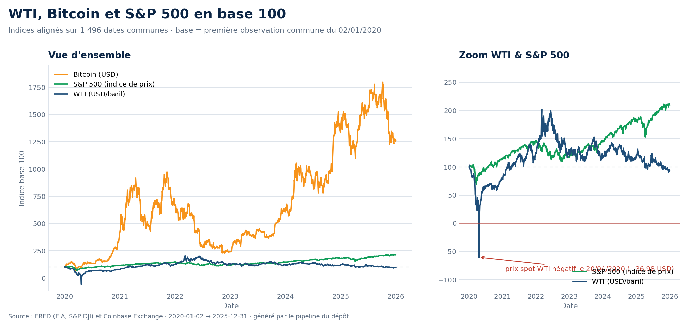
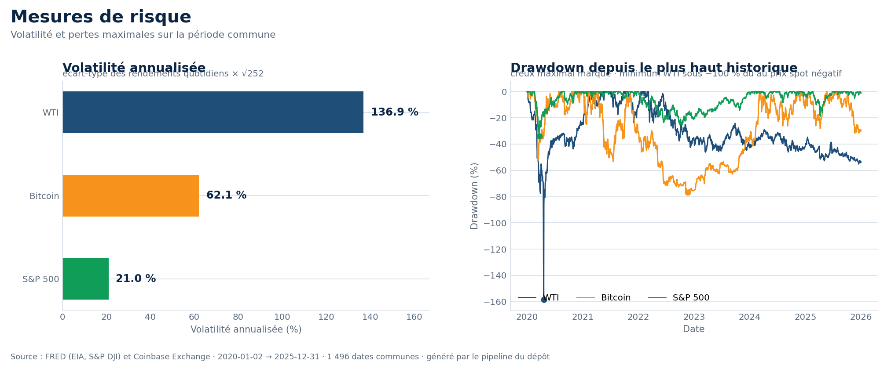
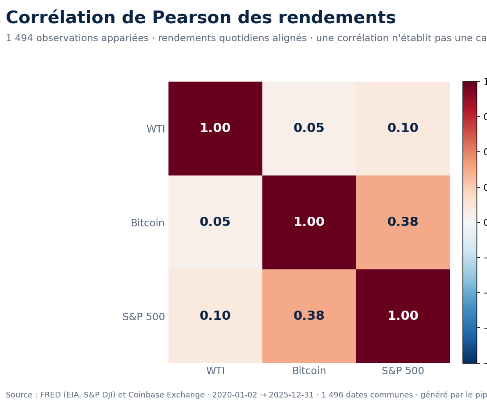
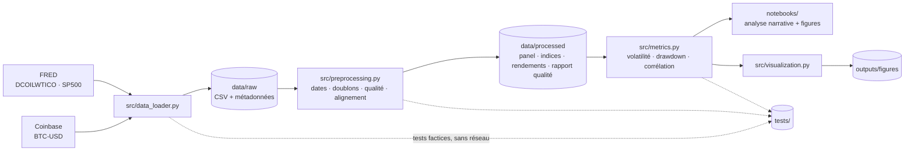

<div align="center">
  

  # Oil, Bitcoin &amp; Equity Market Analysis

  <p><strong>WTI · BTC/USD · S&amp;P 500</strong> — analyse comparative, reproductible et documentée<br>
  sur la période <strong>2020-01-02 → 2025-12-31</strong> (1 496 dates communes)</p>

  <p>
    
    
    
    
    
  </p>
  <p>
    
    
    
    
    
  </p>
  <p>
    
    
    
  </p>
</div>

---

<p align="center">
  
</p>



## 📌 À propos du projet

Ce dépôt répond à une question simple mais exigeante : **que se passe-t-il quand on
compare, sur la même période et le même calendrier, trois marchés qui n'ont rien de comparable ?**

- le **pétrole brut WTI**, une matière première cotée en USD par baril ;
- le **Bitcoin**, un actif numérique coté 7 jours sur 7 et 24 h/24 ;
- l'**indice S&P 500**, un indice boursier de **prix** (hors dividendes).

Les niveaux bruts sont dans trois unités différentes : ils ne sont **pas** comparables
tels quels. Le projet les ramène à une base commune (base 100), aligne les calendriers,
puis calcule rendements, volatilité, drawdowns et corrélations avec des formules
explicites, testées et vérifiables.

> 🎓 Projet pédagogique : chaque chiffre affiché est **calculé par le code**, jamais
> recopié. Les tests s'exécutent sans Internet, les données sont traçables jusqu'à
> leur fournisseur, et les anomalies sont signalées plutôt que masquées.

---

## 📊 Résultats de la dernière exécution réelle

Période commune **2020-01-02 → 2025-12-31** · 1 496 dates communes · 1 494 dates avec
rendements complets pour les trois séries.

| Série | Performance cumulée | Volatilité annualisée (√252) | Drawdown maximal | Jours de hausse |
|:--|--:|--:|--:|--:|
| **WTI** (USD/baril) | −6,4 % | 136,9 % | −158,4 % ⚠️ | 52,7 % |
| **Bitcoin** (USD) | +1 159,9 % | 62,1 % | −76,7 % | 51,7 % |
| **S&P 500** (indice) | +110,1 % | 21,0 % | −33,9 % | 54,4 % |

| Couche d'alignement | Bitcoin | S&P 500 | WTI |
|:--|--:|--:|--:|
| Observations brutes | 2 185 | 1 565 | 1 565 |
| Après intersection des calendriers | 1 496 | 1 496 | 1 496 |

<p align="center">
  
</p>

<p align="center">
  
</p>

### Ce que ces chiffres racontent

1. **Trois trajectories, une seule méthode de comparaison.** Bitcoin termine à 12,6× son
   point de départ, le S&P 500 à 2,1×, le WTI légèrement sous son point de départ.
2. **Le risque n'est pas monotone.** Le WTI affiche la volatilité la plus élevée et un
   drawdown supérieur à −100 % : c'est un **artefact documenté**, lié au prix spot
   négatif du 20/04/2020 (−36,98 USD/baril), pas une perte réellement finançable.
3. **Co-mouvements faibles à modérés.** Sur les rendements quotidiens alignés, la
   corrélation Bitcoin / S&P 500 est la plus élevée, sans qu'aucune causalité ne
   puisse en être tirée.

---

## 🚀 Démarrage rapide

```bash
# 1. Environnement
python3 -m venv --system-site-packages .venv
source .venv/bin/activate
pip install -r requirements.txt

# 2. Télécharger, contrôler et préparer les données
python -m src.pipeline                 # réseau requis
python -m src.pipeline --offline       # réutilise data/raw/ sans réseau

# 3. Vérifier
python -m pytest                       # 86 tests, sans accès Internet
ruff check . && ruff format --check .

# 4. Explorer
jupyter notebook
#   → notebooks/oil_bitcoin_equity_analysis.ipynb
#   → Restart Kernel and Run All Cells
```

> 💡 `curl` doit être présent sur le `PATH` (par défaut sous Linux et macOS).
> Aucune clé API n'est nécessaire : voir [ADR-003](ADR/ADR-003-http-transport.md).

---

## 🏗️ Architecture



**Principe de séparation** : l'acquisition, la transformation, le calcul et la
présentation sont dans des modules distincts. Les fonctions de calcul ne font **jamais**
d'appel réseau, ce qui les rend testables et réutilisables.

| Module | Responsabilité | Testé par |
|:--|:--|:--|
| `src/data_loader.py` | téléchargement, parsing, erreurs réseau explicites | `tests/test_data_loader.py` |
| `src/preprocessing.py` | schéma, dates, doublons, qualité, alignement | `tests/test_preprocessing.py` |
| `src/metrics.py` | base 100, rendements, volatilité, drawdown, corrélation | `tests/test_metrics.py` |
| `src/visualization.py` | figures homogènes (titre, axes, unités, source) | via exécution du notebook |
| `src/pipeline.py` | orchestration des 10 étapes + CLI | `tests/test_pipeline.py` |
| `notebooks/` | narration, tableaux, interprétation | exécution complète vérifiée |

---

## 📐 Méthodologie

| Grandeur | Formule | Convention retenue |
|:--|:--|:--|
| Indice base 100 | `prix_t / prix_base × 100` | base = 1ʳᵉ observation commune (02/01/2020) |
| Rendement simple | `P_t / P_(t-1) − 1` | écart de calendrier ≤ 7 jours, prix précédent > 0 |
| Rendement logarithmique | `ln(P_t / P_(t-1))` | uniquement si les deux prix sont > 0 |
| Volatilité annualisée | `écart-type × √N` | `N = 252` pour le panel aligné (voir ci-dessous) |
| Drawdown | `valeur / plus haut historique − 1` | sur l'indice base 100 |
| Corrélation | Pearson | sur rendements **alignés**, jamais sur les prix |

**Pourquoi `N = 252` pour les trois séries ?** Parce qu'elles partagent le même
calendrier de séances une fois alignées : appliquer `365` à Bitcoin seulement rendrait
la comparaison trompeuse. Le notebook affiche malgré tout la valeur `365` pour montrer
l'effet du choix (× `√365/√252 ≈ 1,20`).

**Règles de non-altération appliquées** : aucune interpolation, aucun forward-fill,
aucun outlier supprimé, aucune donnée fictive en cas d'échec réseau.

---

## 🗄️ Sources de données

| Série | Fournisseur | Identifiant | Unité | Accès | Statut |
|:--|:--|:--|:--|:--|:--|
| WTI spot | FRED (source EIA) | `DCOILWTICO` | USD/baril | CSV public, sans clé | ✅ vérifié |
| Bitcoin | Coinbase Exchange | `BTC-USD` | USD/BTC | API publique `candles` | ✅ vérifié |
| S&P 500 (prix) | FRED (S&P DJI) | `SP500` | points | CSV public, sans clé | ✅ vérifié |

Points d'attention vérifiés et documentés :

- ⚠️ `SP500` est un **indice de prix** : les **dividendes ne sont pas inclus**.
- ⚠️ `DCOILWTICO` est un **prix spot**, pas un contrat à terme, et devient **négatif**
  le 20/04/2020 (−36,98 USD) — observation réelle, traitée explicitement.
- ⚠️ L'API Coinbase refuse plus de **300 bougies** par requête : la période est
  découpée en fenêtres de 290 jours.
- ⚠️ Les CGU de FRED et Coinbase **n'ont pas pu être lues** depuis l'environnement de
  développement : les données brutes restent **hors du dépôt Git**.

---

## 🧪 Tests et qualité

```text
$ python -m pytest
86 passed

$ ruff check .
All checks passed!

$ ruff format --check .
31 files already formatted
```

- 🧩 **86 tests unitaires** sur fixtures synthétiques déterministes.
- 🚫 **Aucun accès réseau** dans la suite unitaire : un transport HTTP factice est injecté.
- 🧮 **Tests numériques vérifiables à la main** : `[10, 20, 15] → [100, 200, 150]`,
  `[100, 110] → 0,10`, `ln(1,1)`, drawdown `100 → 80 = −20 %`.
- 🚨 **Test d'intégrité** : un échec réseau doit produire une erreur explicite, jamais
  une donnée de remplacement.

---

## 📁 Structure du dépôt

```text
.
├── src/                     # acquisition · prétraitement · métriques · figures · pipeline
├── tests/                   # 86 tests unitaires (fixtures synthétiques)
├── notebooks/               # notebook d'analyse en 16 sections
├── docs/images/             # logo, bannière et figures du README
├── data/raw/                # réponses fournisseurs + métadonnées (non versionné)
├── data/processed/          # panel aligné, indices, rendements, rapport qualité
├── outputs/figures/         # figures générées par le notebook
└── ADR/                     # décisions d'architecture et de sourcing
```

---

## 📚 Documentation du projet

| Document | Contenu |
|:--|:--|
| [`PRD.md`](PRD.md) | objectifs, périmètre, fonctionnalités, hors périmètre |
| [`METHODOLOGY.md`](METHODOLOGY.md) | formules, conventions d'annualisation et de drawdown |
| [`DATA_SOURCES.md`](DATA_SOURCES.md) | sources vérifiées, limites, conditions d'utilisation |
| [`DATA_QUALITY.md`](DATA_QUALITY.md) | contrôles effectués et mesures réelles |
| [`DATA_DICTIONARY.md`](DATA_DICTIONARY.md) | schéma des données et des artefacts |
| [`TECHNICAL_DESIGN.md`](TECHNICAL_DESIGN.md) | architecture, flux, principes |
| [`BUSINESS_RULES.md`](BUSINESS_RULES.md) | 20 règles normatives (BR-001 → BR-020) |
| [`TEST_PLAN.md`](TEST_PLAN.md) | couverture de tests attendue et obtenue |
| [`ACCEPTANCE_CRITERIA.md`](ACCEPTANCE_CRITERIA.md) | état réel, critères ouverts |
| [`SETUP_AND_USAGE.md`](SETUP_AND_USAGE.md) | installation, exécution, reproductibilité |
| [`ADR/`](ADR/) | ADR-001 sources · ADR-002 alignement · ADR-003 transport HTTP |

---

## ⚠️ Limites honnêtes

- **Aucune causalité** : corrélation et co-occurrence temporelle ne prouvent rien (BR-017).
- **Clôtures non simultanées** : séance américaine pour le WTI et le S&P 500, minuit UTC
  pour Bitcoin — une date commune ne représente pas le même instant.
- **Valeurs manquantes non comblées** : 65 jours sans cotation pour le WTI, 57 pour le
  S&P 500 ; ils retirent des dates au panel commun.
- **Période biaisée** : 2020-2025 contient le crash covid, la remontée 2021 et le krach
  2022 ; les résultats ne se généralisent pas à d'autres périodes.
- **Échantillon court** : six années ne suffisent pas à conclure sur le comportement de
  long terme de Bitcoin.
- **Données révisables** : une reproduction future peut différer légèrement.

---

## 📄 Licence et mentions

Code sous licence **MIT** (voir [`LICENSE`](LICENSE)).

Projet **éducatif et descriptif** : ce dépôt n'est pas un conseil en investissement.
Les données proviennent de sources publiques (FRED, Coinbase Exchange) et ne sont pas
redistribuées ici ; seules les métadonnées et les figures dérivées sont versionnées.
Les conditions d'utilisation de chaque fournisseur doivent être vérifiées avant toute
publication des données.

<div align="center">
  <p><sub>Réalisé avec <code>pandas</code>, <code>NumPy</code>, <code>Matplotlib</code>, <code>pytest</code> et beaucoup de vérification.</sub></p>
</div>